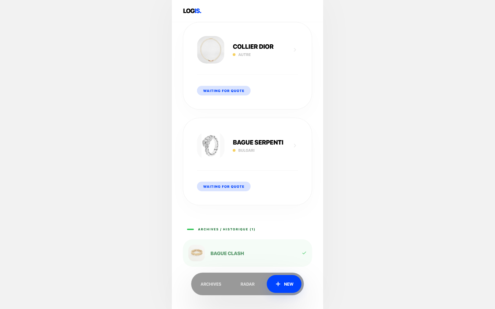
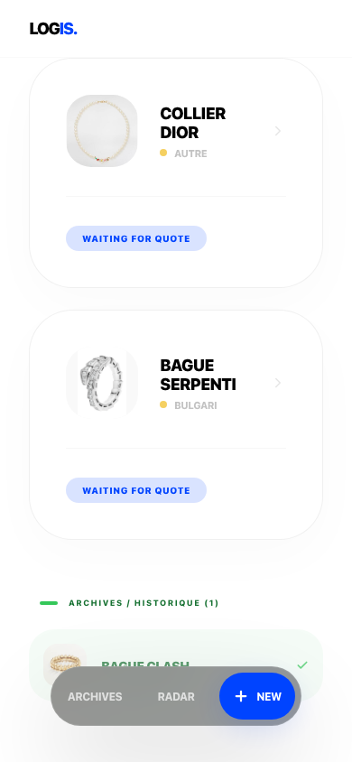

# Reach Logistics

A mobile-first logistics workflow for coordinating custom-product sourcing, supplier quotations, quality control, payments, and delivery.

[Live demo](https://reach-logistics.vercel.app) · [Repository](https://github.com/alkhastvatsaev/logistic)



<details>
<summary>Mobile view</summary>



</details>

## Case study

Small sourcing teams often coordinate product specifications, supplier prices, payment milestones, and shipping updates across chats and spreadsheets. Reach Logistics brings that lifecycle into one focused web application:

1. An operator creates a sourcing request, optionally importing product metadata from a public product URL.
2. The app creates a tokenized supplier link and QR code.
3. A supplier submits manufacturing details, costs, and an estimated delivery date.
4. The operator compares quotes, records deposit and balance payments, uploads quality-control media, and advances the order.
5. The app calculates CNY/EUR costs and margin, exports client and internal PDFs, and records delivery progress.

The interface is intentionally optimized for a narrow mobile viewport while remaining usable on desktop.

## Features

- Realtime request, quote, payment, and activity views
- Lifecycle states from draft and sourcing through production, shipment, and delivery
- Tokenized supplier portal with French and Chinese interface copy
- Supplier-link QR codes and clipboard sharing
- Quote comparison and CNY-to-EUR calculations with a configurable safety margin
- Client proposal and internal financial PDF exports
- Quality-control image/video uploads to Firebase Storage
- Installable PWA manifest and production service worker
- Product-page metadata enrichment with private-network and response-size protections
- Best-effort FedEx status lookup plus manual tracking updates
- Unit tests with Vitest and browser smoke tests with Playwright

## Architecture

- **Next.js 16, React 19 + TypeScript** — UI, route handlers, and server-side integrations
- **Firebase Realtime Database** — requests, quotes, payments, share tokens, and logs
- **Firebase Authentication** — anonymous sessions required by the provided database and storage rules
- **Firebase Storage** — QC media under request-scoped paths
- **jsPDF + html2canvas** — browser-side document generation
- **qrcode.react** — supplier portal QR codes
- **next-pwa** — production service-worker generation
- **Vitest + Playwright** — unit and end-to-end test layers

Business calculations live in `src/lib/logic.ts`, Firebase setup is isolated in `src/lib/firebase.ts`, and remote URL validation is implemented in `src/lib/safeFetch.ts`.

## Local setup

Requirements: Node.js 20+ and npm.

```bash
git clone https://github.com/alkhastvatsaev/logistic.git
cd logistic
npm ci
cp .env.example .env.local
npm run dev
```

Create a Firebase web app with Realtime Database, Storage, and Anonymous Authentication enabled, then fill in `.env.local`. Deploy the included rules after reviewing them for your Firebase project:

```bash
npx firebase-tools deploy --only database,storage
```

The values prefixed with `NEXT_PUBLIC_` are Firebase web-client identifiers and are intentionally sent to the browser. Never place service-account credentials or other private keys in those variables. `EMAIL_INGEST_SECRET` is server-only and should be a long random value.

## Environment variables

See `.env.example` for the complete list:

- `NEXT_PUBLIC_FIREBASE_API_KEY`
- `NEXT_PUBLIC_FIREBASE_AUTH_DOMAIN`
- `NEXT_PUBLIC_FIREBASE_PROJECT_ID`
- `NEXT_PUBLIC_FIREBASE_STORAGE_BUCKET`
- `NEXT_PUBLIC_FIREBASE_MESSAGING_SENDER_ID`
- `NEXT_PUBLIC_FIREBASE_APP_ID`
- `NEXT_PUBLIC_FIREBASE_DATABASE_URL`
- `EMAIL_INGEST_SECRET`

## Quality checks

```bash
npm run lint
npm run typecheck
npm test
npm run build
npm run test:e2e
```

The standard CI workflow runs lint, type checking, unit tests, and a production build. Playwright is kept as a separate local smoke suite because meaningful workflow coverage requires a configured Firebase test project.

## Security and limitations

- Database access is denied by default and restricted to authenticated Firebase sessions, with basic type and size validation. Storage accepts authenticated image/video uploads under `qc/` up to 10 MB.
- Authentication is currently anonymous. It prevents unauthenticated direct access but does **not** provide operator/supplier roles or tenant isolation. Do not use this version for sensitive or multi-tenant production data.
- Supplier links are bearer tokens. Anyone holding a valid link can use the associated portal.
- The email-ingest endpoint requires `Authorization: Bearer <EMAIL_INGEST_SECRET>`.
- Metadata enrichment rejects credentials, non-HTTP protocols, private/reserved network addresses, unsafe redirects, oversized pages, and oversized images.
- Firebase rules are versioned here but are not deployed automatically by GitHub Actions.
- The current Firebase project has no Storage bucket initialized, so QC media
  uploads remain unavailable until Storage is provisioned and the included
  rules are deployed.
- FedEx lookup uses an unofficial public endpoint and may return fallback states. It is not an SLA-backed carrier integration.
- Product metadata extraction uses lightweight HTML matching and may fail on client-rendered or bot-protected pages.
- Financial results are operational estimates, not accounting or tax advice.

## Roadmap

- Replace anonymous access with operator accounts, supplier capabilities, and per-request authorization
- Move privileged writes to Firebase Admin-backed server endpoints
- Add Firebase Emulator Suite integration tests and CI browser tests
- Integrate an official carrier API and signed webhook ingestion
- Add schema migrations, audit retention controls, rate limiting, and monitoring
- Improve accessibility and responsive layouts beyond the mobile-first shell

## Author

Built by [Alkhast Vatsaev](https://alkhastvatsaev.dev) as a full-stack JavaScript/TypeScript portfolio case study — [portfolio](https://alkhastvatsaev.dev) · [Full Stack FR](https://alkhastvatsaev.dev/fr/developpeur-full-stack).
